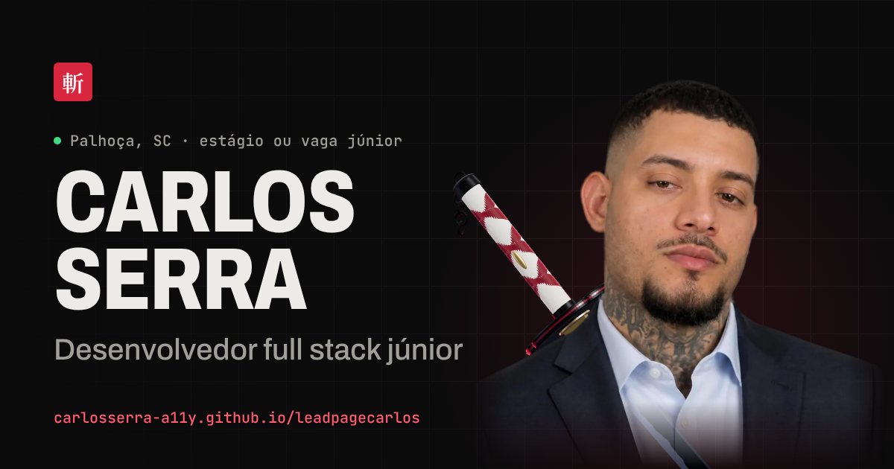

# Carlos Serra · Portfólio

Site pessoal de **Carlos Serra**, desenvolvedor full stack júnior em Palhoça/SC (ADS · FMP).

**No ar:** https://carlosserra-a11y.github.io/leadpagecarlos/



- E-mail: carlosserraap55@gmail.com
- WhatsApp: (48) 99617-0281
- GitHub: https://github.com/carlosserra-a11y

## O que tem na página

| Bloco | Conteúdo |
| --- | --- |
| Topo | Nome, cargo, uma frase do que eu faço, provas (clientes reais, sites no ar, stack) e contato. Retrato recortado com uma zanpakutō 3D (three.js) atrás do ombro |
| Projetos em destaque | Figaro's 2.0, São Cristóvão 3.0 e Smartech 3.0. Cada um com a página inteira rolando dentro da moldura do navegador, o que eu fiz, como conferir e a evolução 1.0 → 3.0 |
| Outros projetos | Ingrid Lima e CS Store, mais a lista de exercícios e primeiros passos (repositórios novos entram sozinhos pela API do GitHub) |
| Sobre | Bio, ficha, stack com o projeto que comprova cada item e linha do tempo |
| Contato | E-mail (com copiar), WhatsApp, GitHub e formulário |

Também: versão em inglês (botão EN), detalhes de cada projeto com link direto (`#caso-figaros`, `#caso-ingrid`…), modo Bankai (botão no rodapé ou tecla **B**), barra fixa de contato no celular e página 404 própria.

## Decisões técnicas

- **Sem framework e sem build para o site.** HTML, CSS e JavaScript clássicos: abre com dois cliques no `index.html` e publica direto no GitHub Pages.
- **3D que não atrapalha.** A katana é modelada só com código em `src/katana3d.js` (lâmina com seção real, hamon em shader, ito trançado em 3D) e empacotada com esbuild em `lib/katana3d.min.js`. A página mostra primeiro um pôster gerado pelo próprio modelo; o 3D só entra depois do carregamento, em aparelhos com GPU, e pausa fora da tela. Sem GPU, em economia de dados ou sem JavaScript fica o pôster. `?3d=1` força o 3D para testes.
- **Movimento com propósito.** GSAP + ScrollTrigger para o topo preso com camadas em velocidades diferentes, os projetos empilhados e a linha do tempo; Lenis só com mouse. Com "reduzir movimento" tudo fica parado e completo.
- **Segurança.** Nenhum script de CDN (tudo em `lib/`), CSP com o hash do único script inline, links externos com `noopener noreferrer` e links do `CONFIG` validados.
- **Qualidade verificada a cada push** (`.github/workflows/qualidade.yml`): HTML válido, links sem erro e Lighthouse com orçamento (`.lighthouserc.json`).

Medido localmente com Lighthouse 12: desempenho 96 no celular e 100 no computador; acessibilidade e SEO 100.

## Estrutura

```
index.html            página
404.html              página de erro
css/style.css         estilos
js/dados.js           textos, contatos, projetos e traduções (edite aqui)
js/app.js             comportamento da página e animações
src/katana3d.js       modelo 3D da katana (fonte)
lib/                  GSAP, ScrollTrigger, Lenis e a katana já montada
assets/foto/          retrato recortado (AVIF/WebP com transparência)
assets/katana/        pôster da katana
assets/projetos/      capturas dos projetos (inclusive a página inteira dos destaques)
ferramentas/          scripts de manutenção (Node)
```

## Como editar

1. Contatos, projetos e textos ficam em `js/dados.js`. Campos vazios do `CONFIG` (ex.: `linkedin`, `curriculo`) somem da página.
2. Depois de mudar textos ou o script inline do `index.html`, atualize fontes e hashes da CSP:
   ```
   node ferramentas/cabecalho.mjs
   ```
3. Depois de mexer na katana (`src/katana3d.js`) ou na pose dela (`const POSE` em `js/app.js`):
   ```
   cd ferramentas && npm install && npx playwright install chromium
   npm run katana && npm run poster
   ```

## Publicação

GitHub Pages a partir da branch `main`, pasta raiz. Cada push na `main` publica em um ou dois minutos.
